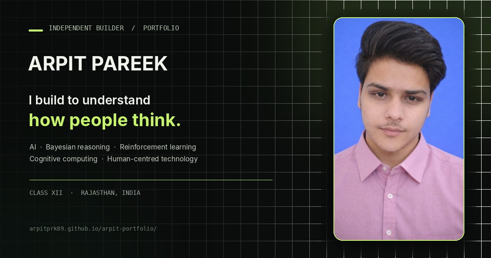

# Arpit Pareek — A Portfolio Built Around Questions

> **I build to understand how people think.**
>
> An independent student portfolio exploring AI, Bayesian reasoning, reinforcement learning, cognitive computing, and technology that supports human decisions.

## Start here

- **Portfolio:** https://arpitprk89.github.io/arpit-portfolio/
- **GitHub:** https://github.com/arpitprk89
- **LinkedIn:** https://www.linkedin.com/in/arpit-pareek-83b533361/
- **ARPIK.AI:** https://arpik-ai.vercel.app/
- **ARPIK.AI story:** https://arpik-ai-story.vercel.app/

## What this portfolio is about

I’m Arpit Pareek, a Class XII PCM student from Shrimadhopur, Rajasthan, India. I learn by turning questions into small, independent builds. My current interests sit where probability, learning systems, human behaviour, and education meet.

This site is a record of that process—not a claim that every idea is finished or scientifically validated. Where a project uses a hypothesis, illustrative values, or a simple model, I aim to make that clear.

## Selected projects

| Project | The question behind it | Explore |
| --- | --- | --- |
| **ARPIK.AI** | Can a student-focused tool help people reflect on choices and opportunities without choosing for them? | [Open app](https://arpik-ai.vercel.app/) · [Read the story](https://arpik-ai-story.vercel.app/) |
| **Brain 2.0** | How might repeated self-reports about study, sleep, stress, exam pressure, and support inform a simple cognitive-load estimate? | [Live project](https://arpitprk89.github.io/Brain-2.0/) · [Source](https://github.com/arpitprk89/Brain-2.0) |
| **RL Visualiser** | How does an agent learn a route through actions, feedback, and rewards? | [Try the visualiser](https://arpitprk89.github.io/rl-visuliser/) |
| **Bayesian Decision Maker** | How can beliefs and decisions change when evidence is uncertain? | [Repository](https://github.com/arpitprk89/bayesian-decision-maker) |
| **Vidya Yatra** | How do school pathways, subject choices, exams, and social expectations shape a student's educational journey? | [Explore](https://arpitprk89.github.io/-Vidya-Yatra/) |
| **33 KOTI** | Can a cultural idea be explored as a hypothesis about recurring qualities and family patterns—without treating it as established science? | [Explore](https://arpitprk89.github.io/33-KOTI/) |
| **Cognitive AI Simulator** | How might a system represent changing internal states alongside choices and a memory log? | [Repository](https://github.com/arpitprk89/cognitive-ai-simulator) |

These projects have different levels of maturity. They are independent learning experiments and should be evaluated on their actual methods and evidence, not on claims of validation they have not established.

## Built with

- **HTML, CSS, and JavaScript** for the responsive portfolio experience
- **Python** in my work on Bayesian decision-making
- **GitHub Pages** for hosting this portfolio
- **Open Graph metadata** and a custom 1200 × 630 image to help the portfolio display a rich preview when shared on supported platforms

## Run it locally

No build step is required.

1. Download or clone this repository.
2. Keep the `assets/` directory beside `index.html`.
3. Open `index.html` in a browser.

## Publish with GitHub Pages

1. Upload `index.html` to the repository root.
2. Upload the complete `assets/` directory without renaming it.
3. Commit the changes and allow GitHub Pages to publish the site.
4. After changing the page's social preview metadata or image, use [LinkedIn Post Inspector](https://www.linkedin.com/post-inspector/) to request a fresh preview. LinkedIn may cache previously fetched cards.

### Keep the preview image working

The page's Open Graph image points to:

`https://arpitprk89.github.io/arpit-portfolio/assets/arpit-link-preview.jpg`

If the repository name, hosting path, or filename changes, update the matching image URL in the metadata inside `index.html`. The image must be publicly reachable for external platforms to fetch it.

## A note on the work

I’m still learning, testing, and revising. The goal is not to make technology sound more certain than it is; it is to make questions clearer, build useful experiments, and show what I learn along the way.

---

**Made by Arpit Pareek · Rajasthan, India**
